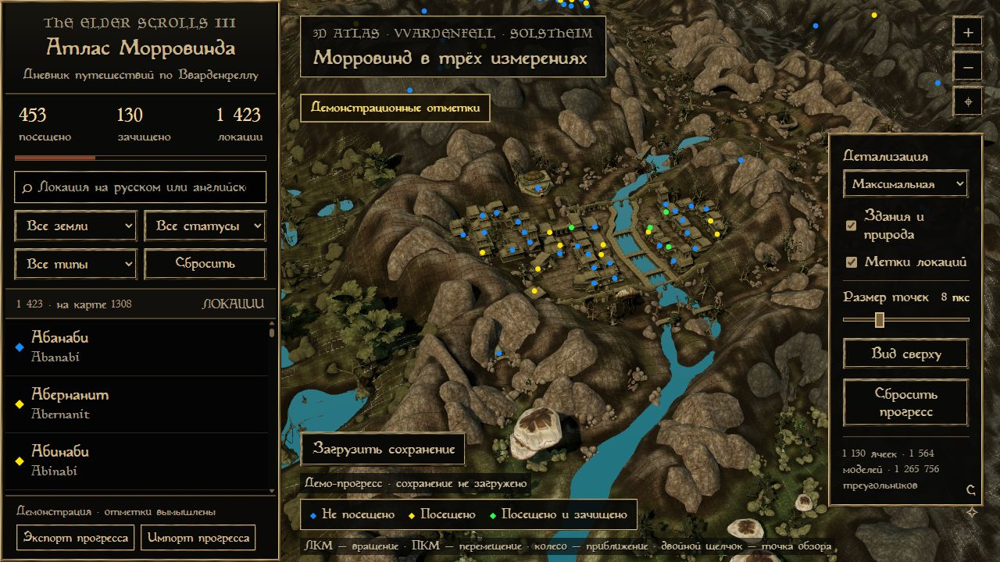
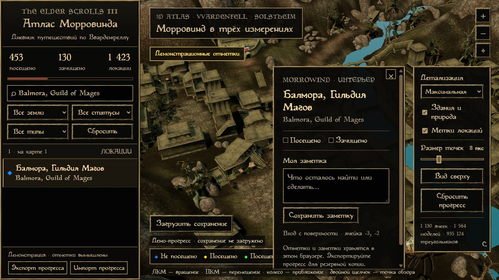
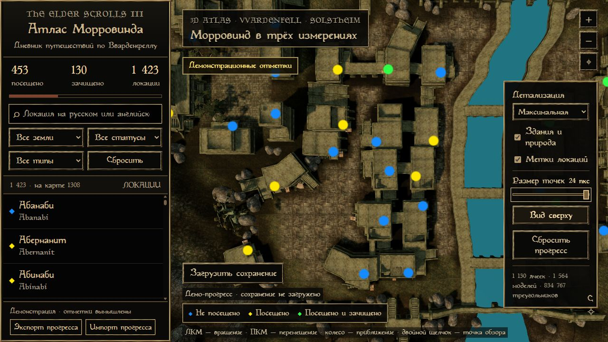

# Morrowind 3D Atlas

Локальная интерактивная 3D-карта Morrowind с загрузкой сохранений OpenMW. Без аккаунтов, облачной базы, телеметрии и внешних сервисов. Интерфейс на русском; названия локаций также доступны на английском.



На скриншотах показаны **демонстрационные, вымышленные отметки**, а не чьё-либо прохождение.

## Возможности

- Рельеф Вварденфелла и Солстхейма из оригинальных игровых данных, здания, мосты, скалы и растительность. Детальные участки подгружаются при приближении.
- Каталог 1 423 локаций. Для 1 308 есть привязка к поверхности; остальные, включая интерьеры Tribunal, доступны в поиске.
- Загрузка `.omwsave` через кнопку на карте. Файл обрабатывается **в браузере**, без отправки на сервер.
- Ручные отметки «Посещено» / «Зачищено», заметки, поиск и фильтры.
- Яркие статусы: **зелёный** — посещено и зачищено; **жёлтый** — посещено; **синий** — не посещено.
- Ползунок размера точек от 2 до 24 пикселей, три уровня детализации, вид сверху.
- Прогресс и настройки остаются в браузере. JSON-экспорт и импорт позволяют делать резервные копии.
- Оформление в духе внутриигровых окон: оригинальные рамки, чёрные панели, бежевый текст. Magic Cards с кириллицей можно подключить из собственного TTF.



## Быстрый старт

Нужны Python 3.10 (другие версии Python пока не проверены), браузер с WebGL2 и собственная установка **Morrowind GOTY с Tribunal и Bloodmoon**. На данный момент сборщик проверен на Python 3.10 в Windows. Используйте оригинальные английские ESM и BSA: каталогу и распознаванию сохранений нужны исходные английские идентификаторы ячеек.

```bash
git clone https://github.com/rastaskin/morrowind-3d-atlas.git
cd morrowind-3d-atlas
python -m pip install -r requirements.txt
python prepare.py --data-files "C:/Games/Morrowind/Data Files"
python serve.py
```

Откройте **http://127.0.0.1:8766/**. Первичная подготовка занимает несколько минут и создаёт локальные ресурсы в `public/assets3d/` и `public/ui/`. Повторный запуск карты не требует повторной подготовки.

Каталог игры задаётся аргументом `--data-files`, жёстко заданных путей к компьютеру автора нет. Сборщик читает ESM/BSA и **не меняет файлы игры**. `serve.py` слушает только `127.0.0.1` и не принимает загрузки: это обычная раздача статических ресурсов.

Не открывайте `index.html` двойным щелчком через `file://`: для модулей и локальных ресурсов нужен HTTP-сервер.

### Шрифт Magic Cards

Необязательный параметр для локального TTF с кириллицей:

```bash
python prepare.py --data-files "C:/Games/Morrowind/Data Files" --font "path/to/Magic-Cards-Cyrillic.ttf"
```

Подготовленный шрифт хранится локально и не включён в этот репозиторий. Без него браузер использует запасной шрифт. Один из вариантов кириллической адаптации — [Magic Cards Cyrillic на FullRest](https://www.fullrest.ru/files/magic_cards_cyrllic2); проверьте условия автора выбранного шрифта.

## Загрузка сохранения

1. Нажмите **«Загрузить сохранение»** и выберите `.omwsave`.
2. Дождитесь проверки карты тумана войны. Новые подтверждённые посещения добавятся к существующим отметкам.
3. При необходимости поставьте «Зачищено» и добавьте заметку вручную.

Поддерживается **OpenMW, формат сохранения 34**. Классические `.ess`, сохранения других игр и другие версии формата пока не поддерживаются. Максимальный размер файла — 512 МБ.

Посещением считается именованный интерьер с раскрытыми пикселями тумана карты. Простое присутствие ячейки в сохранении не считается посещением. Соседние наружные ячейки, прочтение книг и зачистка автоматически не определяются. Имена сопоставляются точно, без учёта регистра. Неизвестные модовые помещения пропускаются; их количество показывается после импорта.

Импорт добавляет посещения, сохраняя заметки и ручные отметки зачистки. Сначала проверяется весь файл; ошибка разбора не применяет частичный прогресс. Сам файл сохранения, его имя, имя персонажа, уровень и время игры не сохраняются приложением.

## Управление

| Действие | Управление |
| --- | --- |
| Вращение камеры | Левая кнопка мыши |
| Перемещение | Правая кнопка мыши |
| Приближение | Колесо или кнопки `+` / `−` |
| Выбрать точку обзора | Двойной щелчок по поверхности |
| Перейти к локации | Нажать результат поиска |
| Полный обзор | Кнопка с прицелом или `Home` при фокусе на карте |
| Размер точек | Ползунок справа; также стрелки клавиатуры при фокусе |



## Прогресс и приватность

Данные хранятся в `localStorage` текущего браузера для адреса, на котором открыта карта. Другой браузер, порт или очистка данных сайта создают отдельное пустое прохождение. Для переноса используйте **«Экспорт прогресса»** и **«Импорт прогресса»**. Перед сбросом или очисткой браузера сохраните резервную копию.

Приложение не содержит авторизации, ключей API, адресов личных баз, сохранений игроков или исходного пользовательского прогресса. В репозиторий не включены игровые архивы, извлечённые модели, текстуры и шрифты. Каталог содержит только названия локаций и их географические привязки; новые прохождения начинаются с нулевых отметок.

Для воспроизводимых иллюстраций можно открыть `http://127.0.0.1:8766/?demo`. Демо использует вымышленные отметки в памяти, показывает соответствующую плашку и не записывает их в настоящий прогресс. Импорт и редактирование в этом режиме отключены.

Подробнее: [PRIVACY.md](PRIVACY.md).

## Ограничения

- Геометрия и текстуры соответствуют **оригинальной игре**, а не современному ремастеру. Сборщик не воспроизводит модифицированный мир целиком.
- В 3D представлены наружные статические объекты. NPC, существа, анимации и внутренние планы подземелий не визуализируются.
- Связанные интерьеры располагаются на карте у их наружного входа. Наличие маркера не означает отдельную наружную дверь для каждой комнаты.
- Производительность зависит от видеокарты. Для слабого устройства уменьшите детализацию или отключите здания и природу.
- Полные ресурсы нужно подготовить на своём компьютере; один исходный репозиторий без игровых файлов не содержит готовый мир.

## Разработка и проверки

Для тестов нужен Node.js 18 или новее, установка npm-пакетов не требуется:

```bash
npm test
python scripts/check_release.py
```

Тесты проверяют разбор сохранений, границы бинарных записей, отбор посещённых интерьеров, отказ от неподдерживаемых форматов, сохранение заметок, резервные копии и ошибки локального хранилища. Для проверки нативного декодирования PNG в браузере можно создать искусственное сохранение командой `python tests/make_browser_fixture.py`: файл появится в игнорируемом каталоге `.tmp/`.

`check_release.py` проверяет файлы, предназначенные для Git, на игровые бинарные ресурсы, приватные пути, токены и адреса облачных баз. Каталоги с генерируемыми ресурсами и сохранениями исключены через `.gitignore`. Это дополнительная проверка, а не замена осмотру публикации и скриншотов.

## Лицензии и источники

Код проекта — [MIT](LICENSE). Включённая Three.js 0.180.0 и OrbitControls — MIT, [текст лицензии](public/vendor/LICENSE-three.txt).

Morrowind и связанные игровые материалы принадлежат их правообладателям. Лицензия кода не распространяется на игровую графику, шрифты и данные. Их подготовка предназначена для локального использования из вашей копии игры; не коммитьте `public/assets3d/` и `public/ui/`.

Описание форматов сверялось с исходниками OpenMW: [ландшафт](https://github.com/OpenMW/openmw/blob/master/components/esm3/loadland.cpp), [дверные переходы](https://github.com/OpenMW/openmw/blob/master/components/esm3/cellref.cpp), [туман карты](https://github.com/OpenMW/openmw/blob/master/components/esm3/fogstate.cpp). Проект не является официальным продуктом Bethesda или OpenMW.
