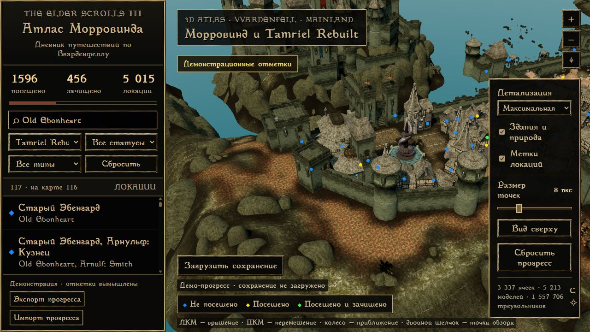
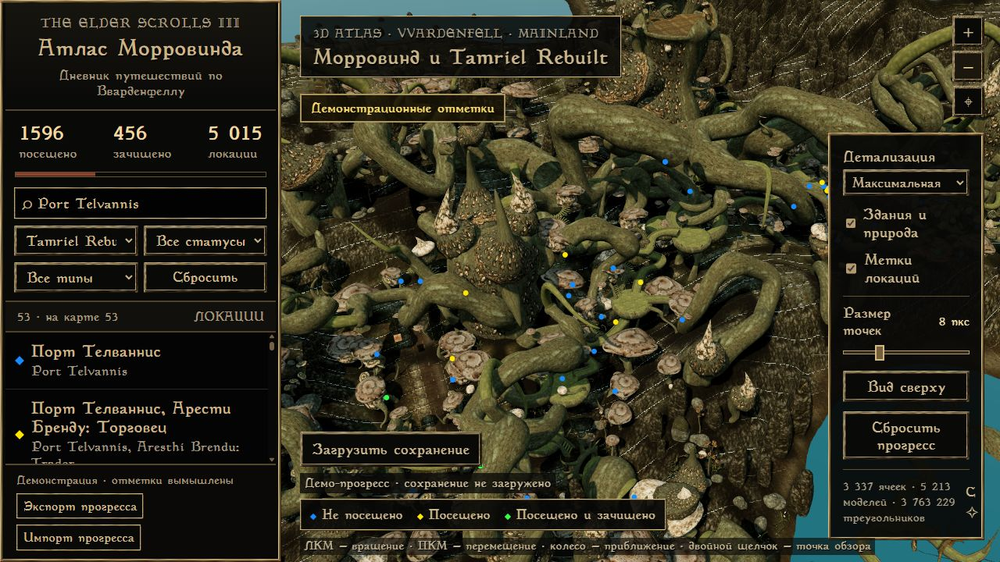

# Tamriel Rebuilt — 1.5.0

Атлас теперь строит материковый Морровинд из установленного Tamriel Rebuilt и Tamriel_Data. В окне подготовки есть переключатель мода и выбор конфигурации OpenMW. Читаются распакованные ресурсы, архивы TES3, кодировка и порядок выбранных TR-патчей с зависимостями.

Локальный каталог получает новые локации, русский перевод из таблиц `.cel`, английские названия и подтверждённые связи помещений с внешними входами. В фильтре земель появляется Tamriel Rebuilt. Старые идентификаторы базовых локаций сохраняются; импорт ESS и OpenMW добавляет подтверждённые посещения материка по точным названиям и явным переводам.

Большие наборы материалов рельефа поддерживают более 256 текстур. Экспорт моделей выполняется четырьмя процессами, поддерживает NiCollisionSwitch и скрывает служебные маркеры редактора. Шрифт встроен также в окно запуска и используется без установки в Windows. Отдельные истории для новых мест пока заменены явно подписанным общим контекстом TR.

Проверены 34 теста JavaScript и 21 тест Python, чтение сохранения без изменений, сохранность старых идентификаторов, подготовка полного мира из упакованного EXE, встроенный шрифт и отображение двух материковых городов. На проверенной конфигурации: 5 015 локаций, из них 3 592 из TR; 3 337 ячеек рельефа, 5 213 моделей, 562 500 объектов и 500 материалов рельефа. Ошибок экспорта моделей и отсутствующих текстур рельефа не было. Числа зависят от установленного выпуска модов.

Игровые ресурсы, локальные пути, сохранения и пользовательский прогресс в установщик и репозиторий не входят. Для TR требуется заново подготовить локальные ресурсы с включённым модом. Обычная карта GOTY продолжает работать.
